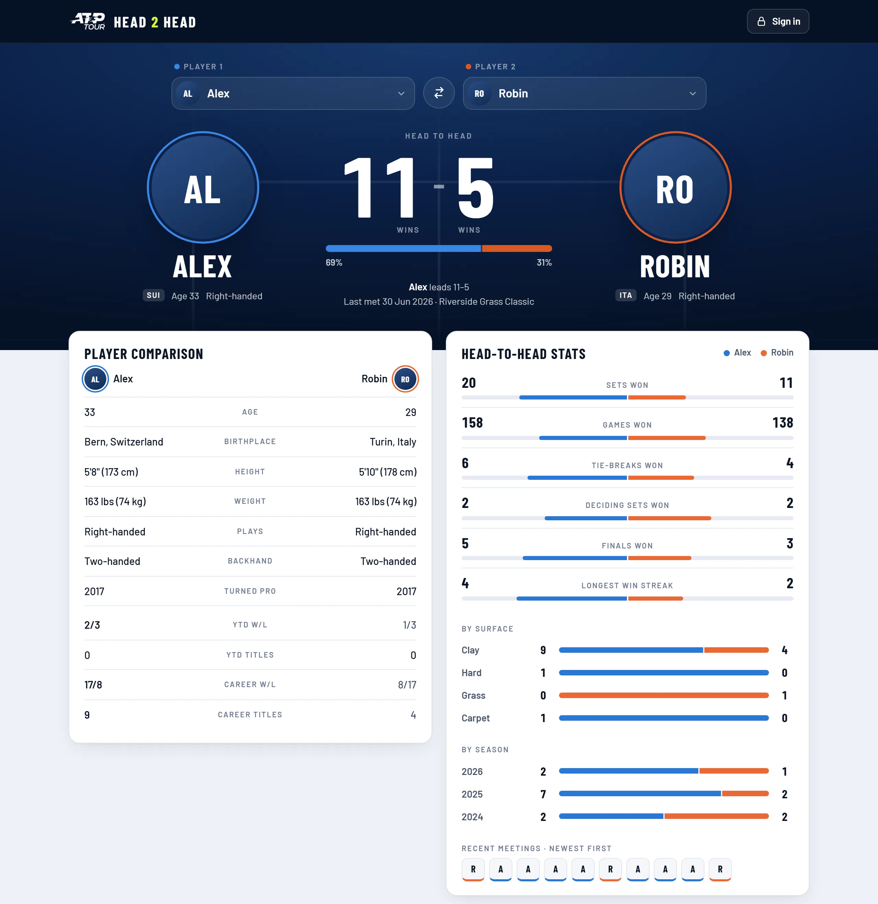
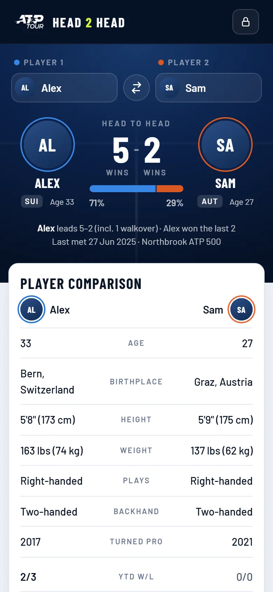
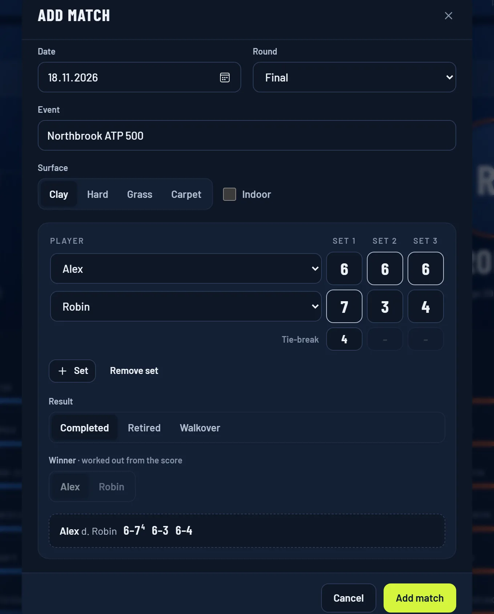
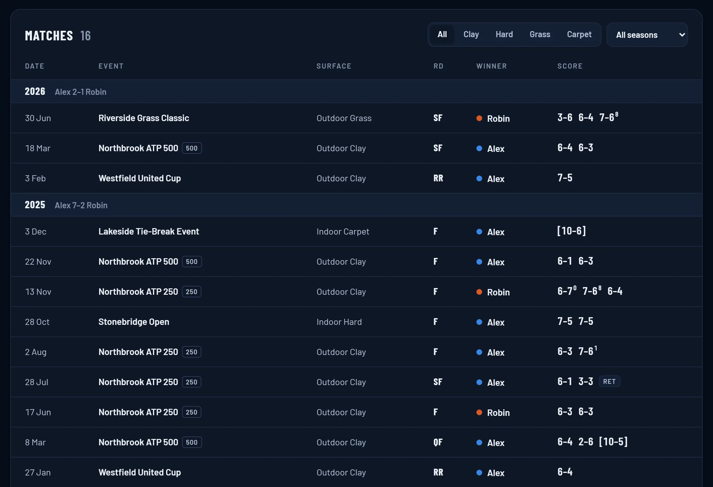

# Head 2 Head

Head-to-head tennis records for a group of friends, styled like a pro-tour H2H page.



- **One page for every matchup.** Pick two players with the search fields (or swap them). The
  selection is kept in the URL (`?p1=alex&p2=robin`), so any matchup can be bookmarked or shared.
- **Everything is calculated from the match list:** H2H record, sets, games, tie-breaks, deciding
  sets, finals, streaks, breakdowns by surface and season, YTD and career W/L and titles.
- **Admin mode.** Sign in with a password to add or edit matches with a scoreboard-style score
  entry (the winner is worked out from the sets) and to add or edit players, including a photo.
- **Simple database.** SQLite by default (a single file, nothing to set up), MySQL optional.
- Works on phones, follows the system light or dark mode.

<p>
  
  
</p>



*The screenshots show the included demo data: all players and results are fictional.*

## Deploying (bplaced or any PHP host)

Requirements: PHP 7.4+ with `pdo_sqlite` (most hosts have it) or a MySQL database.

1. Copy `config.sample.php` to `config.php` and set `admin_password`. `config.php` is ignored by
   git, so the password never ends up in the repository.
2. Upload these to your web space: `index.html`, `api.php`, `config.php`, `.htaccess`, `assets/`,
   `lib/` and `data/`. You don't need `dev-server.js`, `package.json` or `tests/` on the server.
3. Make sure PHP can write to `data/` (on most hosts it already can; otherwise `chmod 775 data`).
4. Open the site. On the first request the database `data/h2h.sqlite` is created and filled
   with the demo data from `data/seed.json` (fictional players and results).

`data/` and `lib/` are blocked from web access via `.htaccess`. If your host has no SQLite,
set a MySQL DSN in `config.php`; the tables are created automatically.

## Backups

As admin, **Backup** downloads all players and matches as JSON. To restore one (or to move
to another server), replace `data/seed.json` with the backup and delete `data/h2h.sqlite`:
the next request rebuilds the database from it. You can also just copy the `data/h2h.sqlite`
file around: the local dev server and PHP use the same format.

## Local preview

No PHP needed, just Node.js 22.13 or newer:

```sh
npm run dev        # http://localhost:8000, admin password: admin
npm test           # checks the score rules and statistics
```

The dev server (`dev-server.js`) serves the site and implements the same API as `api.php`
on Node's built-in SQLite. Use `H2H_PASSWORD=… PORT=… npm run dev` to change the defaults.

## Scoring conventions

- Scores are entered per set; enter tie-break points (of the set loser) for 7–6 sets. They are
  shown as 7–6⁴, the way pro tours show them.
- A "set" of 10+ points such as 10–8 is treated as a match tie-break and shown as `[10–8]`.
- **Retired**: enter the score at the moment of retirement and pick the winner.
  **Walkover**: no score, just the winner.
- Walkovers count in the head-to-head record but not in W/L records (like the original site).
  A title is a final won.

## Project layout

```
index.html            the single page
assets/css/app.css    styles (light + dark)
assets/js/app.js      state, URL handling, rendering
assets/js/editors.js  admin dialogs (sign in, match, player, players list)
assets/js/picker.js   searchable player combobox
assets/js/stats.js    H2H / career statistics
assets/js/model.js    validation and score rules, shared with dev-server.js
api.php               JSON API (production)
lib/store.php         database access, schema, seeding
lib/validate.php      PHP port of model.js validation
data/seed.json        demo data (fictional players and results)
dev-server.js         local server without PHP
docs/screenshots/     README images (not needed on the server)
```
